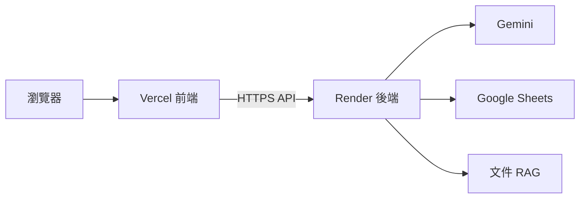

這篇示範把 Data Machi 的 FastAPI 後端部署到 Render，把 React 前端部署到 Vercel，接著確認登入、健康檢查與跨來源請求。

## 先確認 GitHub 是正式版本來源

部署前，先確認目前要上線的程式碼已經提交（Commit）並推送（Push）到 GitHub。Render 與 Vercel 都會從程式碼儲存庫取得程式，因此不要再以本機某個未提交版本作為「真正最新版」。

如果專案同時有前端與後端資料夾，也要先確認各自的根目錄（Root Directory）、啟動指令與相依套件檔案是否清楚。這一步如果混亂，後面平台設定再正確也無法成功建置（Build）。

## 第一步：部署 FastAPI 後端到 Render

後端先上線，因為前端最後需要知道後端網址。建立 Render 網頁服務後，連接 GitHub 程式碼儲存庫，指定後端所在的根目錄，再設定建置指令（Build Command）與啟動指令（Start Command）。

若使用 Data Machi 的 `render.yaml`，建置與啟動指令從 GitHub 儲存庫根目錄執行：

```text
Build Command: cd backend && pip install -r requirements.txt
Start Command: cd backend && uvicorn main:app --host 0.0.0.0 --port $PORT
```

如果改由 Render 控制台手動把 Root Directory 設為 `backend`，請從指令移除 `cd backend &&`。啟動時監聽 `0.0.0.0`，並依 [Render Web Service 文件](https://render.com/docs/web-services) 使用平台提供的 `$PORT`。

先設定共用模型金鑰、登入設定與允許的前端來源：

```env
GOOGLE_API_KEY=
SUPABASE_URL=
SUPABASE_SERVICE_ROLE_KEY=
ALLOWED_ORIGINS=
```

使用舊式 HS256 簽章的 Supabase 專案需要相符的 `SUPABASE_JWT_SECRET`，請只設在後端。如為全新部署，請在 Supabase 執行專案的 `backend/supabase_schema.sql`，依應用程式 README 初始化第一位管理員，再核准其他測試帳號。Render 部署需要 `SUPABASE_SERVICE_ROLE_KEY` 才能讀寫成員資料。Google Sheets、Confluence、Trello 等整合，再依需要加入對應的憑證。

<Warning>
  部分免費方案在閒置後可能休眠，下一次請求需要等待服務重新啟動，第一次回答可能明顯較慢。前端應顯示清楚的連線與等待狀態，正式使用時也要評估方案限制。
</Warning>

## 先做健康檢查，再測 AI

開啟 `https://your-backend.onrender.com/health` 確認後端服務有回應，再用已核准的測試帳號登入前端，依序測聊天、Google Sheets 和文件查詢。

## 第二步：部署 React 前端到 Vercel

後端網址確認後，再建立 Vercel 專案，連接同一個 GitHub 程式碼儲存庫，指定前端的根目錄與建置設定。前端需要知道 API 要連到哪裡，因此把 Render 後端網址放進 Vercel 的環境變數。

開發環境可能使用 `localhost`，正式環境（Production）則必須指向 Render 的正式網址。這也是為什麼網址不應硬寫死在程式碼裡。所有 API 呼叫最好統一從同一個環境變數或共用 API Client 讀取，而不是散落在多個元件中：

```env
VITE_API_URL=https://your-backend.onrender.com
VITE_SUPABASE_URL=https://your-project.supabase.co
VITE_SUPABASE_ANON_KEY=your_supabase_anon_key
```

<Warning>
  Vite 預設會向前端程式碼公開 `VITE_` 變數。這裡使用 Supabase 的公用金鑰。共用模型金鑰、`SUPABASE_SERVICE_ROLE_KEY` 和外部資料憑證只配置在後端。詳見 [Vite 環境變數](https://vite.dev/guide/env-and-mode)。
</Warning>

Vercel 通常也會為每個 Branch 或 Pull Request 建立 Preview URL，主要分支則對應 Production URL。Preview 很適合檢查前端版面與基本流程，但如果後端 CORS 只允許 Production URL，Preview 可能無法呼叫 Render——這也是下一步要處理的事。

## 第三步：處理跨來源資源共享（CORS）

前後端分開部署後，瀏覽器會把 Vercel 與 Render 視為不同來源。即使後端本身正常，若跨來源資源共享設定不正確，瀏覽器仍可能擋掉請求。

在 `ALLOWED_ORIGINS` 列出允許的前端來源，包含協定和網域，必要時加上連接埠。用逗號分隔多個來源。CORS 是瀏覽器的跨來源規則；後端仍需驗證登入和資料權限。詳見 [FastAPI CORS 文件](https://fastapi.tiangolo.com/tutorial/cors/)。

```env
# Render
ALLOWED_ORIGINS=https://your-app.vercel.app,http://localhost:5173
```

三種環境的網址關係可以先整理成一張表，避免設定時互相搞混：

| 環境 | 前端 URL | 後端 URL | 用途 |
| --- | --- | --- | --- |
| Local | `localhost:5173` | `localhost:8000` | 本機開發 |
| Preview | Vercel Preview URL | Render 測試服務 | PR 驗收 |
| Production | 正式 Vercel URL | 正式 Render URL | 使用者服務 |

若請求仍然失敗，可以用這張表快速定位問題層：

| 現象 | 優先檢查 |
| --- | --- |
| 瀏覽器顯示 CORS，Render 沒收到請求 | 可能在 Preflight（`OPTIONS`）階段被擋 |
| Render 收到 `OPTIONS` 但沒有 `POST` | 檢查 CORS 允許的 Methods／Headers |
| Vercel 仍呼叫舊網址 | 環境變數更新後尚未重新部署 |
| 本機正常、正式失敗 | 正式 URL 或 allowlist 未同步 |
| Postman 正常、瀏覽器失敗 | Postman 不受瀏覽器 CORS 限制，不能當作前端測試的替代 |



## 第四步：做一輪基本驗收測試（Smoke Test）

正式上線後不要只測「首頁打得開」，而要沿著真正的使用路徑跑一輪。這一組測試的目的，是確認本機能工作的能力到了正式環境後仍然正常。

| 測試項目 | 通過條件 |
| --- | --- |
| 後端健康檢查 | 服務回傳正常狀態，而不是逾時或 5xx 錯誤 |
| 一般聊天 | 前端可以成功連到後端並取得回答 |
| PDF RAG | 可以找到文件、回答並顯示來源 |
| Google Sheets | 能成功讀取測試試算表並算出預期結果 |
| 跨來源問題 | 協調者能依序使用兩個以上來源並整合回答 |
| 錯誤憑證 | 系統顯示可理解的權限錯誤，而不是整個頁面崩潰 |
| 模型或工具逾時 | 能重試、使用備援，或明確告知使用者失敗原因 |
| 跨來源資源共享（CORS） | 正式 Vercel 網址可存取後端，未授權來源則不應任意開放 |
| 重新部署 | 必要的資料、索引或設定不應因重新部署而意外消失 |

另外再人工檢查三件事：機密資訊是否沒有出現在 GitHub、前端瀏覽器或錯誤訊息中；預覽環境是否和正式環境使用不同的資料權限；主要錯誤是否能從執行紀錄追查。

可以用這種格式留下每次部署的結果：

| ID | 測試項目 | 預期結果 | 實際結果 | 通過 |
| --- | --- | --- | --- | --- |
| PROD-01 | 後端健康檢查 | 回傳正常狀態 | 回傳正常狀態 | ✅ |

這樣每次部署後都能用同一份清單快速確認，而不是等使用者回報問題才知道某個環節失效。

## 部署不是結束，而是把問題搬到真實環境

正式環境出現錯誤時，維護團隊可先用健康檢查、瀏覽器請求和後端紀錄定位問題，再檢查對應的環境變數、CORS、服務帳號權限、檔案路徑、套件版本或持久化設定。

## 延伸閱讀｜部署成功之後，才進入正式產品準備

Render 與 Vercel 上線只是第一步。企業產品還需要回答四個問題：**怎麼測、怎麼看、怎麼存、怎麼安全地更新。** 這四件事分別對應測試（Testing）、可觀測性（Observability）、持久化（Persistence）與持續整合／部署（CI/CD）。

### 測試：不要只靠人工聊天

至少要保留幾種固定測試：基本驗收測試確認服務活著；路由測試（Routing Test）確認不同問題會走到正確工具；結構測試（Schema Test）確認結構化輸出欄位沒有因模型或提示詞更新而漂移。更進一步，可以把 Day 19 的路由評估與 Day 10 的 RAG 評估納入每次發布前的回歸測試（Regression Check）。

### 可觀測性：知道系統「怎麼完成」答案

對代理系統而言，執行紀錄不應只記最終回答。開發端最好能查到工作階段、分流結果、呼叫過哪些工具、延遲時間、錯誤、模型、Token 使用量與總耗時。這些資訊不是要暴露給一般使用者，而是讓維護者在結果變差時知道問題出在哪一層。

```text
工作階段
  ├─ 分流與上下文判斷
  ├─ 呼叫過的工具
  ├─ 資料來源與延遲
  ├─ 模型與 Token 使用量
  ├─ 驗證結果
  └─ 最終狀態
```

### 持久化：重新部署後，資料不能全部消失

Render 的預設檔案系統是暫時性的。Data Machi 可將試算表與 Confluence 登記清單、術語等設定存到 Supabase Postgres；保存在後端檔案系統的文件和索引，則要確認儲存路徑是否掛載持久磁碟。會議紀錄和待辦可保存在瀏覽器的 IndexedDB，換裝置或清除站台資料前要先備份。詳見 [Render 檔案系統說明](https://render.com/docs/faq)。

### 持續整合與部署：讓每次修改都有最低安全網

GitHub 推送後可以自動跑程式碼檢查、型別檢查、單元測試與基本驗收測試，再進入建置與部署。AI 程式開發助手可以讓修改速度變快，但修改愈快，越需要自動測試來防止功能退步。

[Day 30](/30-days/day-30-design-your-enterprise-agent) 有驗收與交接清單，可接著用來檢查這次部署。
