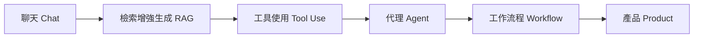

主管問：「今年哪一類工單最多，相關改善專案進行到哪裡？」分析團隊通常得切換試算表、內部文件和專案看板，才能給出一個可以核對的答案。Data Machi 以這類企業內部需求為起點，示範如何把資料查詢、計算與驗證接成一段工作流程，以及團隊在上線前如何確認權限、處理例外並完成驗收。

系列每五天安排一個階段。企業團隊可沿用工單案例，也可以選一項經常重做的業務任務，逐步整理資料來源、執行規則和驗收計畫。

## 第一階段｜Day 01–05：從聊天到企業 AI

前四天用工單問題拆解知識工作，看看模型有哪些公司資料可以用，以及哪些規則需要寫進程式。Day 05 介紹 Data Machi 的前後端、資料來源與開發環境。

| Day | 主題 |
| --- | --- |
| 01 | 企業 AI 如何從回答問題走到完成工作？ |
| 02 | 知識工作的五個步驟：FUDAT |
| 03 | 為什麼 AI 不知道你公司的事？ |
| 04 | 提示詞與工作流程 |
| 05 | Data Machi 全貌 |

## 第二階段｜Day 06–10：讓 AI 找到企業知識

第二階段集中處理檢索增強生成（RAG）。從基本概念開始，接著理解 PDF 如何經過解析（Parse）、文件切割（Chunking）、向量化（Embedding）與建立索引（Index），並比較關鍵字搜尋與語意搜尋。Day 09 會處理掃描 PDF、表格與圖片等真實文件問題，Day 10 則完成第一個能引用來源的 PDF RAG。

| Day | 主題 |
| --- | --- |
| 06 | 什麼是檢索增強生成（RAG）？ |
| 07 | PDF 如何變成可搜尋知識？ |
| 08 | 關鍵字搜尋與語意搜尋 |
| 09 | 掃描 PDF、表格與圖片 |
| 10 | 實作：建立第一個 PDF RAG |

## 第三階段｜Day 11–15：從文件檢索走向工具使用

先比較文件檢索和直接查詢系統的用途，再看 LangChain 怎麼接工具。Day 13 查 Google Sheets，Day 14 盤點資料來源，Day 15 把試算表、文件和專案進度放進同一個查詢案例。

| Day | 主題 |
| --- | --- |
| 11 | RAG 找到文件，為什麼還不夠？ |
| 12 | 工具使用與 LangChain |
| 13 | 實作：Google Sheets 資料工具 |
| 14 | 企業知識地圖 |
| 15 | 實作：跨來源查詢 |

## 第四階段｜Day 16–20：從工具走向代理

Day 16–18 介紹代理怎麼選工具、讀取結果和決定下一步。Day 19 設計協調者，Day 20 用跨來源案例練習判斷哪些查詢可以同時跑、哪些要等上一個結果。

| Day | 主題 |
| --- | --- |
| 16 | 工具使用什麼時候變成代理？ |
| 17 | ReAct 決策循環 |
| 18 | 路由器與協調者 |
| 19 | 實作：建立協調者 |
| 20 | 多來源代理工作流 |

## 第五階段｜Day 21–25：把代理變成可控工作流程

Day 21 處理對話記憶，Day 22 練習判斷何時追問、重查或拒答，Day 23 討論代理循環的限制。Day 24 介紹 LangGraph 的狀態、節點與連線，Day 25 把前一階段的設計整理成工作流程規格。

| Day | 主題 |
| --- | --- |
| 21 | 代理記憶 |
| 22 | 追問、重查與拒答 |
| 23 | 代理循環的限制 |
| 24 | LangGraph：狀態、節點與連線 |
| 25 | 實作：可控 LangGraph 工作流程 |

## 第六階段｜Day 26–30：從展示原型走向產品

Day 26 處理逾時、重試與備援，Day 27 設計進度與錯誤提示，Day 28 整理憑證、權限與治理。Day 29 示範把後端部署到 Render、前端部署到 Vercel。Day 30 整理驗收、交接及第一版範圍。

| Day | 主題 |
| --- | --- |
| 26 | 逾時、重試與備援 |
| 27 | 代理使用者體驗 |
| 28 | API 金鑰、權限與企業治理 |
| 29 | 實作：Render 與 Vercel 部署 |
| 30 | 從聊天到產品 |

## 如何閱讀這套系列

- **主管與專案負責人**依序看 [Day 01 工單情境](/30-days/day-01-enterprise-ai-is-not-chatbot)、[Day 05 試點範圍](/30-days/day-05-data-machi-origin)、[Day 15 跨來源回答](/30-days/day-15-cross-source-workflow)、[Day 28 權限治理](/30-days/day-28-meeting-to-action-items)與 [Day 30 成效驗收](/30-days/day-30-design-your-enterprise-agent)。這條路線從工作需求開始，一路看到試點可以交付什麼，以及何時適合擴大。
- **實作者**可以從 [Day 01](/30-days/day-01-enterprise-ai-is-not-chatbot)依序閱讀。若團隊已有原型，可直接從 [Day 10 文件驗證](/30-days/day-10-rag-is-not-enough)、[Day 25 工作流程規格](/30-days/day-25-human-in-the-loop)或 [Day 29 部署驗收](/30-days/day-29-security-testing-deployment)切入。
